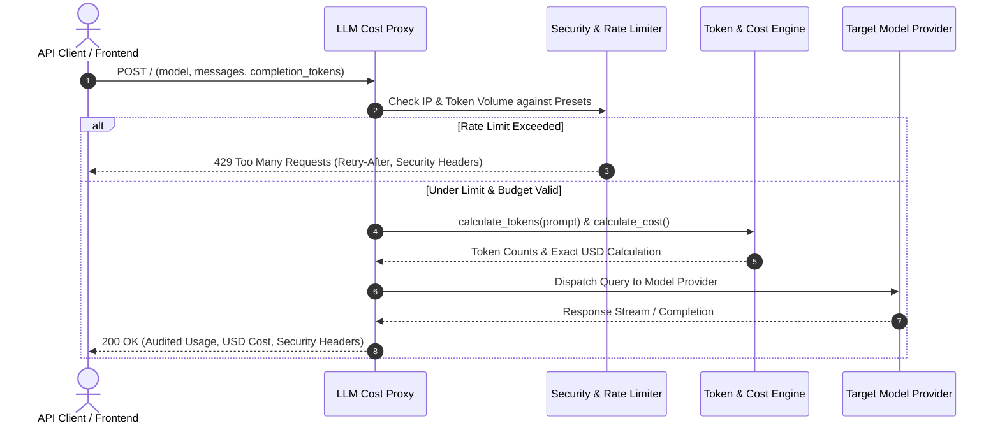

# 💸 llm-cost-proxy

> **Topics:** `llm` `token-counter` `cost-tracking` `openai` `anthropic` `gemini` `ai-proxy` `api-gateway`


[](https://github.com/shadialhasan/llm-cost-proxy/releases/tag/v1.0.0)
[](LICENSE)
[](https://github.com/shadialhasan)
[](https://github.com/shadialhasan/llm-cost-proxy/actions)

A reverse proxy microservice for monitoring LLM token consumption, calculating real-time dollar expenditure across major model providers (OpenAI, Anthropic, Google Gemini), enforcing sliding-window rate limits, and defending budget guards with production security headers.

---

## 🏗️ Architecture & Request Flow

The following Mermaid sequence diagram illustrates the architectural flow of requests through the proxy, token estimation, rate limiting, and cost attribution:



---

## ⚡ Features

- **Token Arithmetic**: Heuristic prompt token counting (~4 characters/token) and exact completion token tracking.
- **Multi-Model Cost Engine**: Built-in pricing for `gpt-4o`, `gpt-4o-mini`, `claude-3-5-sonnet`, `claude-3-haiku`, `gemini-1.5-pro`, and `gemini-1.5-flash`.
- **Rate Limiting Presets**:
  - `strict`: 20 RPM / 20,000 TPM
  - `standard`: 60 RPM / 100,000 TPM
  - `relaxed`: 120 RPM / 500,000 TPM
- **Enterprise Security Headers**: Automatic injection of `Content-Security-Policy`, `X-Content-Type-Options: nosniff`, `X-Frame-Options: DENY`, `Strict-Transport-Security`, and `Cache-Control`.
- **Zero External Dependencies**: Operates entirely with the Python standard library.

---

---

## ⚙️ Installation & Setup

```bash
git clone https://github.com/shadialhasan/llm-cost-proxy.git
cd llm-cost-proxy
pip install -r requirements.txt
```

## 🚀 Usage & Instructions

1. Copy and adjust the environment configuration:
```bash
cp .env.example .env
```

2. Start the proxy server:
```bash
python proxy_server.py
```

3. Send a test inference request:
```bash
curl -X POST http://localhost:8080 \
  -H "Content-Type: application/json" \
  -d '{"model": "gpt-4o", "messages": "Explain distributed systems consensus in two paragraphs.", "completion_tokens": 150}'
```

4. Check proxy health & aggregated session costs:
```bash
curl http://localhost:8080/
```

---

## 🧪 Automated Testing

Execute the automated test suite covering token arithmetic, pricing calculation, rate limit enforcement, and HTTP security headers:

```bash
python -m unittest discover -s tests -p "test_*.py" -v
```

---

## 👤 Author & Maintainer

**Eng. MHD. Shadi AL-Hasan**  
- **Role:** Executive CTO & Enterprise Solutions Architect  
- **Email:** [mhd.shadi.alhasan@gmail.com](mailto:mhd.shadi.alhasan@gmail.com)  
- **Phone / WhatsApp:** [+963934005922](tel:+963934005922)  
- **Location:** Damascus, Syria  
- **GitHub:** [shadialhasan](https://github.com/shadialhasan)  

---

## 📄 License

This project is licensed under the MIT License - see the [LICENSE](LICENSE) file for details.  
Copyright (c) 2026 **MHD. Shadi AL-Hasan**. All rights reserved.